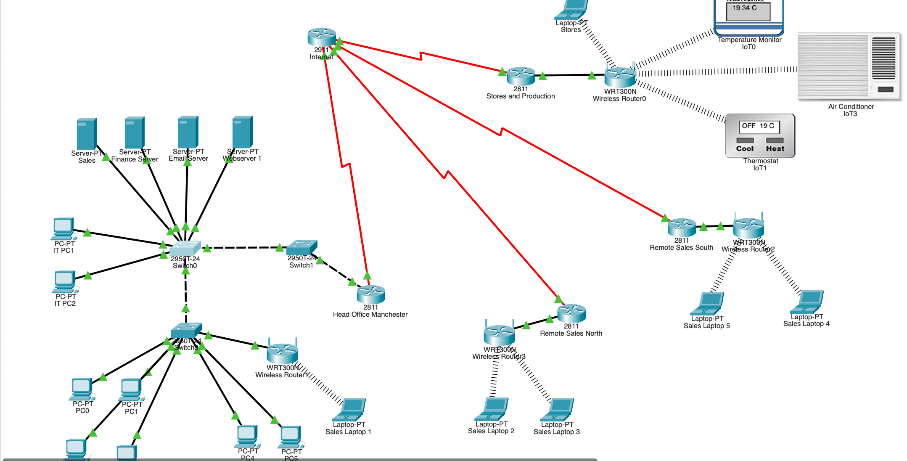
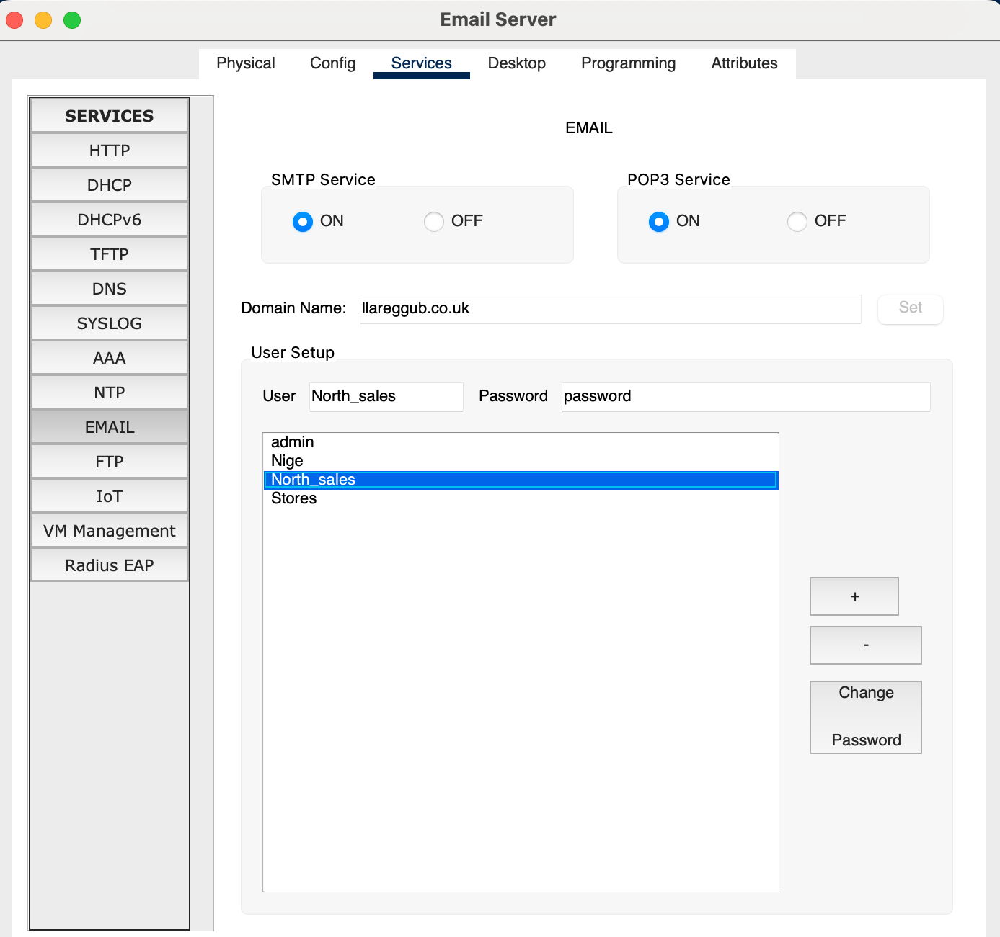
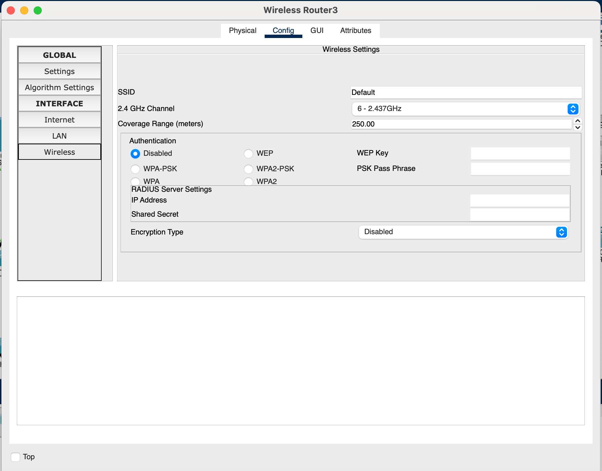
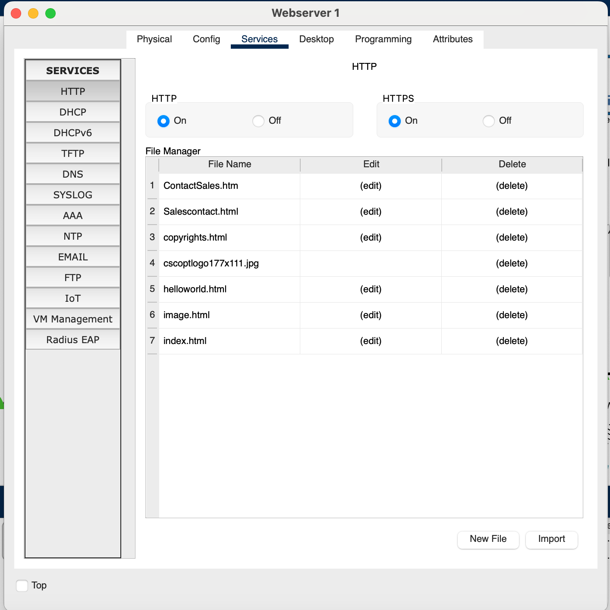
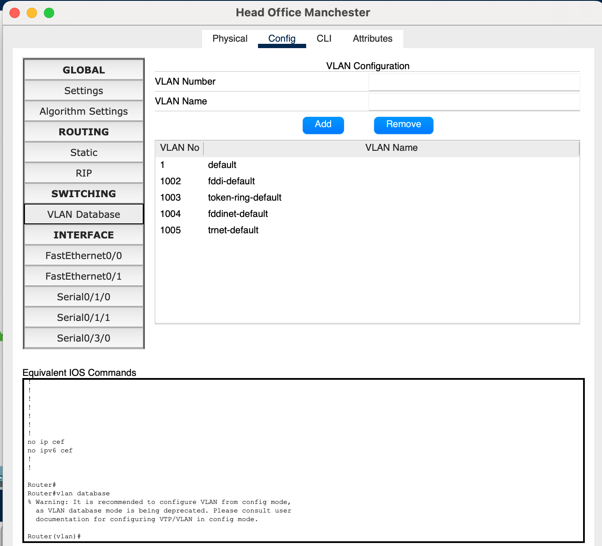
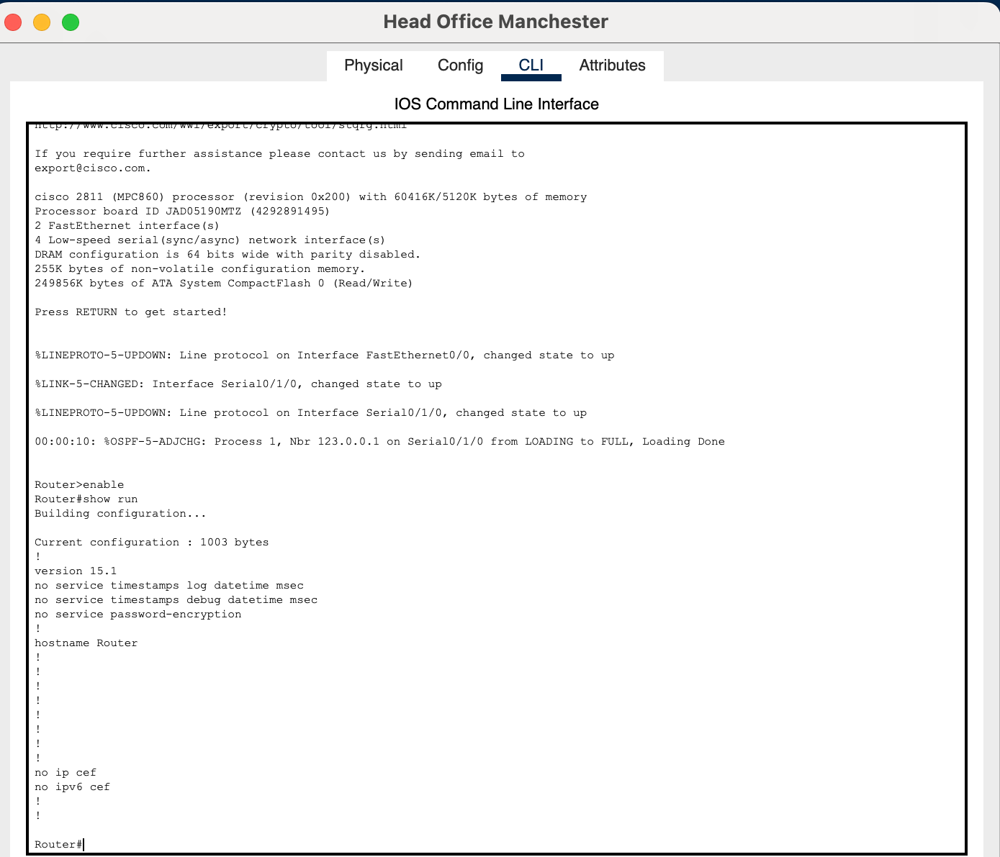

# Multi-Site Network Security Vulnerability Assessment

**Tools:** Cisco Packet Tracer | Network Security | Risk Assessment  
**Project type:** Academic vulnerability assessment (simulated enterprise network)

## Project overview

For this university assignment, I was given an existing multi-site network for a fictional organisation, Llareggub, and asked to assess its security. The network connected a head office in Manchester with remote sales sites and a stores/production site containing IoT devices.

I used **Cisco Packet Tracer** to review the network layout and device configurations, identify weaknesses, assess the possible risks and recommend improvements. I also compared my findings against the organisation's supplied authentication, firewall, wireless-security and remote-access policies.

**Scope:** This was a configuration review and risk assessment. The original assignment did **not** require me to implement or test the recommended fixes, so the findings below should not be read as evidence of a hardened network.

## Network overview

*Figure 1. Supplied network topology showing the connected sites, network devices and services.*

## Assessment approach

1. Reviewed the network topology, including routers, switches, servers, wireless devices and IoT systems.
2. Examined relevant configurations in Packet Tracer for authentication, encryption, segmentation and router security.
3. Compared observed weaknesses with the supplied organisational security policies.
4. Assessed potential impacts and proposed practical security improvements.

## Key findings

| Area | Evidence from the assessment | Risk identified | Assessment severity* |
| --- | --- | --- | --- |
| Weak authentication | Email user accounts were configured with predictable passwords, and some device authentication controls were not clearly visible. | Unauthorised account or device access | High |
| Insecure communications | Wireless Router3 had authentication disabled. The web server had both HTTP and HTTPS enabled, and the report showed HTTP access from a client. | Unauthorised wireless access and possible interception of unencrypted traffic | Critical (encryption section) |
| Limited segmentation | The inspected VLAN database displayed the default and reserved VLANs, without additional departmental VLANs in that view. | Greater potential for access between sensitive systems if other controls are inadequate | High |
| Router and traffic-filtering weaknesses | Router configuration displayed `no service password-encryption`; the assessment found no visible ACL-based restrictions in the examined settings. | Exposure of configuration secrets and unnecessary network access | Medium–High |

*Severity labels reflect my original academic assessment, not a formal CVSS score. Findings about missing controls are limited to what was visible in the configurations I reviewed.*

## Supporting evidence

### 1. Weak email account credentials

*Figure 2. Email server configuration displaying a predictable password on a lab account. The supplied authentication policy called for stronger authentication controls.*

### 2. Wireless authentication disabled

*Figure 3. Wireless Router3 configured with authentication disabled, contrary to the organisation's wireless-security requirements.*

### 3. HTTP remains enabled on the web server

*Figure 4. Web server configuration showing that HTTP and HTTPS were enabled. The original assessment also observed a client accessing the site over HTTP, indicating that encrypted web access was not enforced for that request.*

### 4. Limited departmental VLAN separation in the inspected view

*Figure 5. The device's VLAN database shows VLAN 1 and reserved VLANs 1002–1005; no custom departmental VLANs appear in this screenshot. This is a scoped observation, not proof that no segmentation exists anywhere in the network.*

### 5. Router security configuration

*Figure 6. Head office router CLI showing `no service password-encryption`. This demonstrates a configuration weakness; password obfuscation alone would not replace strong secrets and secure administrative access.*

## Recommended improvements

- **Authentication:** Replace weak/default passwords, use individual accounts and apply MFA where supported, especially for sensitive systems.
- **Wireless security:** Require WPA3 where supported, or the strongest compatible standard available, with a strong passphrase and appropriate separation from internal systems.
- **Encrypted services:** Prefer HTTPS for web services and SSH for device administration; disable unnecessary insecure services.
- **Network segmentation:** Separate sensitive servers, end users, guests and IoT devices where appropriate, with tested inter-network access rules.
- **Traffic filtering:** Introduce and validate ACL/firewall rules aligned with the organisation's requirements, and review logs for suspicious activity.

## Outcome and what I learned

This assessment helped me practise reading an enterprise-style network topology, reviewing device configurations, connecting technical weaknesses to business risks and writing recommendations based on organisational policies.

The main deliverable was a **vulnerability assessment and remediation proposal**, not a completed network-hardening implementation. The screenshots above were taken during my original university investigation.

## Notes

- All examples come from a **simulated academic network**; they do not describe a live organisation.
- The underlying university-supplied Packet Tracer file and policy documents are not included in this repository.
- Screenshots of the original assessment are included as evidence. No real passwords or personal data should be published.
